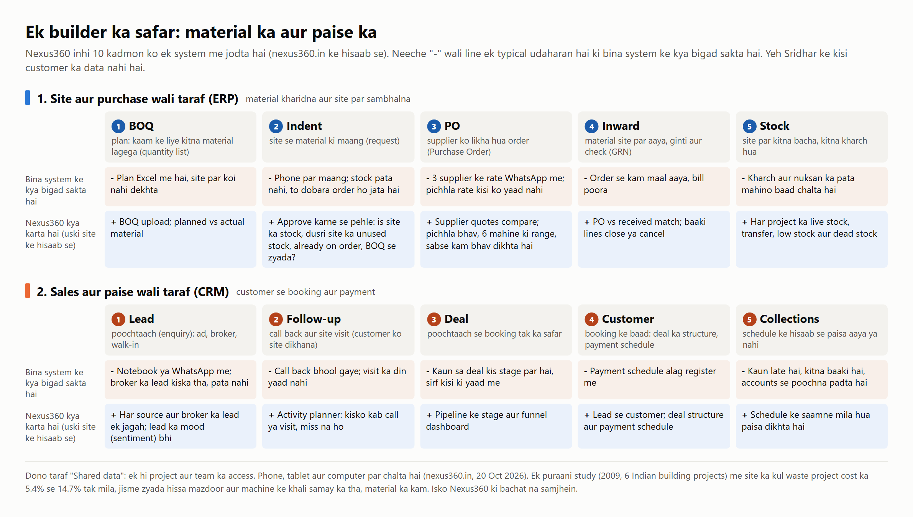
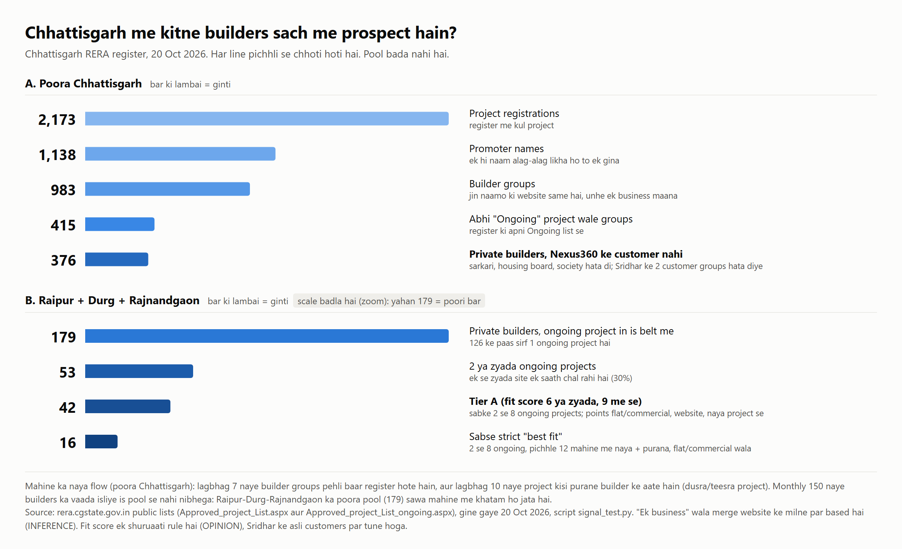

# Nexus360 aur uske buyers: aapke liye simple Hinglish me

Tue 20 Oct 2026. Sirf aapke liye (Sridhar ko mat bhejna). Sridhar ko bhejne wala English half page alag file me hai: `what_we_understood_en.md`.

Har baat ke saath ek label hai:
- **FACT** = kisi page ya file me dekha, source likha hai.
- **INFERENCE** = facts se meri samajh. Galat ho sakti hai.
- **OPINION** = meri salah.
- **ASSUMPTION** = andaza, jiska source nahi. Hamesha range me likha hai.

Is file ke saath: `pool_funnel.png` (kitne builders prospect hain), `builder_day_flow.png` (builder ka ek safar), `signal_test.py` + `signal_test_output.txt` (ginti kaise nikali), `site_sample_output.txt` (40 websites ki jaanch).

---

## 0. Ek minute me

1. **Nexus360 kya hai.** Builder ke liye ek hi system. Ek taraf material kharidna aur site stock (ERP), doosri taraf enquiry se payment collection tak (CRM). Sridhar ki apni site kehti hai ki yeh 2020 me Evergreen City ke liye bana, "Diaries + Excel" ki jagah. Ab 20+ projects aur 200+ log use karte hain (unka apna daava). [FACT: nexus360.in, sridharpatnaik.com]
2. **Yeh kaise bikta hai.** Sridhar ki site par price nahi hai, "WhatsApp par demo book karo, ya email se price poochho". Server har company ka alag, white-label, customise hota hai. Evergreen ne pehle kai ready ERP dekhe, phir custom chuna. Isse lagta hai yeh "app khareedo aur chalao" nahi, **consultant ke saath chalne wala system** hai. Matlab sale lambi aur bharose par tikegi. [FACT + INFERENCE]
3. **Kaun khareedta hai.** Paisa owner/partner ka, par system chalega ya marega site ke staff, purchase aur accounts ki wajah se. [INFERENCE, section 3]
4. **Asli competitor.** Tally + Excel + WhatsApp (yaani kuch na badalna). Paid rivals me Makanify Rs 1,000 per user per month, SiteSetu Rs 2,500 per project per month (abhi ka offer), Tally Rs 22,500 ek baar. [FACT, section 4]
5. **Pool chhota hai.** Chhattisgarh RERA ke hisaab se abhi 376 private builders ke project chal rahe hain (Sridhar ke customers hata kar). Raipur-Durg-Rajnandgaon me 179. Unme se 2 ya zyada project wale sirf 53, aur "Tier A" fit sirf 42. Mahine me lagbhag 7 naye builder aur 10 "dusra project" wale aate hain. [FACT, section 5]
6. **Hamari pehli top-20 list galat type ki thi.** 20 me se 13 builders ke paas sirf 1 ongoing project hai. ERP ke liye weak fit. Ranking badalni chahiye (section 5.4).
7. **Hum Sridhar ko asal me kya bech rahe hain** (ek line, section 7): "Har hafte Chhattisgarh ke un builders ki chhoti, saaf list jinke project abhi chal rahe hain, asli malik ka naam source ke saath, ek sawaal wala WhatsApp, aur jo jawab de wo seedha Sridhar ke paas."
8. **Estimate ke liye teen baatein** (section 7.4): (a) "mahine me 150 naye builders" Chhattisgarh me nahi chalega, pool khatam ho jayega. (b) Deals ya demos ka vaada mat karo. (c) Madhya Pradesh automatic nahi hai.

---

## 1. Nexus360 asaan bhasha me

### 1.1 Ek line

Builder ka kaam do jagah bigadta hai: **site par** (material kitna mangaya, kitna aaya, kitna bacha) aur **sales me** (enquiry kiski thi, call back hua ya nahi, paisa aaya ya nahi). Nexus360 in dono ko ek hi jagah jodta hai.

### 1.2 Sridhar ki apni "pehle aur baad" (uski site se)

| Jagah | Pehle | Baad | Source |
|---|---|---|---|
| Evergreen City (real estate, 2020) | Diaries + Excel, leads aur inventory | Connected ERP + CRM, sales aur inventory | sridharpatnaik.com, 20 Oct 2026 |
| Mahavir Group (real estate, 2021 se) | Site par likha nahi | BOQ se material indent aur PO jode, ERP + CRM, aur ek website | sridharpatnaik.com, greyboard.in/work.html |
| Thermocare (manufacturing, builder nahi) | WhatsApp + Excel | Ek purchasing system, purchasing ke WhatsApp messages "hazaaron per hafte se zero" (unka apna daava) | sridharpatnaik.com |

[FACT hai ki site yeh kehti hai. Daave verify nahi hue.] Isse pata chalta hai ki Sridhar khud kaunsa dard dekhta hai: **diary, Excel aur WhatsApp**.

### 1.3 Chaar udaharan (typical, Sridhar ke customers ka data nahi) [INFERENCE]

1. **Double order.** Site engineer phone par bolta hai "cement khatam". Purchase wala order de deta hai. Par dusri site par cement unused padi thi. Nexus360 indent approve karne se pehle yeh dikhata hai: is site ka stock, dusri site ka unused stock, already on order, similar recent indent, aur BOQ se zyada to nahi. [FACT: features.php]
2. **Rate yaad nahi.** Steel ke 3 supplier ne WhatsApp par rate bheje. Pichhli baar kis bhav liya, kisi ko yaad nahi. Nexus360 PO banate waqt last price, 6 mahine ki range aur sabse kam bhav dikhata hai. [FACT: features.php]
3. **Enquiry ghoom gayi.** Ad ya broker se enquiry aayi, notebook me likhi, call back bhool gaye. Activity planner aur pipeline isliye hain. [FACT: features.php]
4. **Paisa kab aayega.** Booking ke baad payment schedule alag register me. Kaun late hai, accounts se poochna padta hai. Nexus360 customer ka payment schedule aur mila hua paisa saath dikhata hai. [FACT: features.php]

**Waste kitna hota hai?** Ek hi puraani study mili: Ramaswamy aur Kalidindi, 2009, 6 Indian building projects. Total waste project cost ka 5.38% se 14.70%, par zyada hissa mazdoor aur machine ke khali samay ka tha, material ka kam. [FACT: iglc.net/Papers/Details/667]. Hume koi Indian study nahi mili jo chori ya over-ordering alag se naap kare. **Yeh figure Nexus360 ki bachat nahi hai. Sridhar ya builder ko "X% bachega" mat bolna.**

### 1.4 Site par kya nahi likha (poochna hai) [FACT: features.php me "Not mentioned"]

- Tally se connection. (Evergreen ke page par Tally ka zikr hai, par product me nahi.)
- Excel se data import ya export.
- Offline chalna (site par network kamzor ho to).
- Hindi screens.
- Price, onboarding ka time, support ka time.
- RERA ke kaam: 70% account ka hisaab, quarterly update, CA certificate. (Features me nahi hai.)
- Data export ya lock-in ka jawab.

Site par jo security likha hai: har company ka alag VPS server, alag database, role-based access, record ka revision history. [FACT: features.php]

### 1.5 Do aur cheezein jo humne dekhi

- **Sridhar already ads chalata hai.** Nexus360 ki privacy page kehti hai ki log "Google ya Meta ads ke lead form" se details bhejte hain (page 28 Sep 2026 ko update hui). Matlab uska ek inbound raasta pehle se hai. Hume poochna hai ki woh kitna kaam karta hai, warna hum usi ko dohra rahe honge. [FACT: nexus360.in/privacy.php]
- **Key-person risk.** Sridhar apni site par khud ko "Technology Advisor" likhta hai aur Nexus360 ko "my AI-powered ERP and CRM". GreyBoard ki site par do log dikhte hain (technology aur strategy). Builder zaroor poochhega: "agar aap nahi mile to?" [FACT + INFERENCE]

---

## 2. Chhote shabdon ka matlab

| Shabd | Matlab ek line me |
|---|---|
| **BOQ** (Bill of Quantities) | Plan ki list: is kaam me kitna cement, steel, tile lagega. |
| **Indent** | Site se material ki maang. "Hume 100 bag cement chahiye." |
| **PO** (Purchase Order) | Supplier ko likha hua order, rate aur quantity ke saath. |
| **Inward / GRN** | Maal site par aaya, ginti aur check hui, entry hui. |
| **Stock aur consumption** | Site par kitna bacha aur kitna kharch hua. |
| **Collections** | Customer se schedule ke hisaab se paisa lena. |
| **Site visit** | Customer ko project dikhane ka din. Sales ka bada hissa. |
| **RERA** | Real estate ka sarkari niyam aur register. Har builder ko project register karna padta hai. |
| **RERA 70% account** | Customer se aaye paise ka 70% alag bank account me, sirf us project ke kharch ke liye (Act ki Section 4(2)(l)(D)). [FACT: taxguru/Cyril Amarchand] |
| **QPR / quarterly update** | Har quarter RERA portal par project ki progress upload karna. Chhattisgarh RERA ke circulars isse jude hain. [FACT: rera.cgstate.gov.in] |
| **Tally** | Accounts ka software jo shayad zyadatar builders ke paas hota hai [INFERENCE]. Evergreen ki work page par Tally alag chalta dikhta hai (cash/UPI payments "Tally se alag" likhe jaate hain), isliye Nexus360 ko Tally ka replacement na samjho. |
| **ERP / CRM** | ERP = kharid, stock, kharch. CRM = customer aur enquiry. |

---

## 3. Kaun khareedta hai

**Yeh poora section INFERENCE hai** (humne kisi builder se interview nahi kiya). Evidence sirf Sridhar ki site, vendor pages aur RERA circulars se hai. Sridhar ke pichhle 5 customers se confirm karna sabse sasta test hai.

### 3.1 Log aur unka rol

| Kaun | Kya chahta hai | Kya darta hai | Kitna zor |
|---|---|---|---|
| **Owner / partner** | Paisa kahan ja raha hai, har project ka sach, kam chori | Paisa laga kar system na chale; staff naraz; data bahar jaye | Haan ya na wahi bolta hai |
| **Accounts head / CA** | PO, bill aur payment match ho; RERA ka hisaab; audit | Tally aur naye system me double entry; purana data le jana | Rok sakta hai |
| **Purchase manager / project head** | Jaldi order, supplier se rate | Rate aur discretion khule dikhne lagenge (sensitive baat, seedha mat bolna) | Chup chaap rok sakta hai |
| **Site engineer / store keeper** | Phone par aasan entry, kam kaam | Zyada entry, galti par daant | System chalega ya nahi, yahi tay karta hai |
| **Sales head / CRM team / channel partner** | Lead na khoye, site visit fix ho | Apna kaam naapa jana, broker ka lead dikh jana | Sales wali taraf ke liye mukhya |

Evergreen ke page par Sridhar khud likhta hai ki team ko "agreed way of working" apnana tha. Yaani **adoption (log use karein)** hi asli kaam hai. [FACT: greyboard.in/work.html]

### 3.2 Kya khareedne ka mauka banata hai (triggers) [INFERENCE, jahan FACT hai wahan likha]

- **Naya project launch / registration.** Register me dikhta hai. [FACT, 202 project pichhle 12 mahine me]
- **Dusra ya teesra project.** Owner ki yaad se kaam nahi chalta. [FACT: 117 of 202 naye project purane builder ke hain]
- **RERA ka compliance dabav.** Chhattisgarh RERA ke circulars me quarterly update, agreement for sale upload, aur annual audit report ke due date hain. Ek circular (1 Oct 2026) ne 2025-26 ki annual audit report ki date badhayi. [FACT: rera.cgstate.gov.in, 20 Oct 2026]
- **Project late ho raha hai.** Ongoing list me 41 project apni original end date nikal chuke hain. [FACT]
- **Chori ya over-ordering pakdi gayi.** [INFERENCE, koi measured data nahi]
- **Naya finance ya project head aaya** jo control chahta hai. [INFERENCE]
- **Partner, bank ya investor ne hisaab maanga.** [INFERENCE]
- **Sales ka kharcha badha** (ads, brokers) aur enquiry ka hisaab nahi. [INFERENCE]

### 3.3 Abhi ve kya use karte hain [INFERENCE, vendor claims se support]

Tally (accounts) + Excel + WhatsApp groups + diary/register. Kuch ke paas Sell.do, Makanify ya Zoho jaisa CRM ya local developer ka bana tool. Kuch ke paas kuch nahi.
Support: Sridhar ka "pehle" (Diaries + Excel) aur SiteSetu ka page (jo kehta hai ki team WhatsApp par updates daalti rehti hai aur SiteSetu unhe file kar deta hai). Hamari 40 websites ki jaanch me 22 chalu sites par **Sell.do, Makanify, Zoho ya HubSpot ek bhi nahi dikha, LeadSquared 1 par**, aur Tally ya ERP ka shabd 0 par. Yaani zyadatar prospect ke paas koi dikhne wala rival system nahi hai. [FACT, chhota sample]

### 3.4 Unke darr, aur Sridhar ke paas jawab

| Darr | Jawab jo site se milta hai | Jawab jo poochna hai |
|---|---|---|
| Data migration, Tally ka mel | Evergreen me Tally ke saath kaam kiya (FAQ) | Tally connection, Excel import? |
| Staff virodh | "Process pehle, software baad me" (GreyBoard ka tareeka) | Training, onboarding kaun karta hai? |
| Price | Site par nahi | Price band (range chalegi) |
| Lock-in, chhota vendor | Alag server har company ka, white-label | Data export, backup, agar Sridhar na mile to? |
| "Mere competitor ka software?" | Server alag, data alag | Kya customer references de sakte hain? |
| "Dusra software phir se?" | Customise hota hai | Kitne din me chalu? |

---

## 4. Competition aur price anchors

Sab prices public pages se, **20 Oct 2026 ko dekhe**, rupaye me, GST alag, jahan bataya wahan alag. Jahan source weak hai wahan likha hai.

| Product | Kya karta hai | Public price | Kahan kamzor / alag |
|---|---|---|---|
| **Makanify** | Sales CRM, inventory, demand letter, channel partner, WhatsApp. "50+ builders" (unka daava). | Builder plan **Rs 1,000 per user per month**, saal bhar ka bill, GST alag. WhatsApp credits alag. 7 din trial. [makanify.com/pricing, page par date nahi] | Page par site material, purchase ya accounts ka alag module nahi dikha. |
| **Sell.do** | Sales taraf ka bada platform. "1,500+ customers, 150+ developers" (unka daava). | Quote par. "Per active user per month, kam se kam 5 users." Unka blog market range Rs 700 se Rs 3,000+ per user per month batata hai (apna rate nahi). [sell.do/pricing, sell.do/blog 17 Aug 2026] | Site purchase wali taraf page par nahi dikhi. |
| **SiteSetu** | Site operations: WhatsApp updates ki daily report, indent, PO, GRN, BOQ drawing se. | App **Rs 2,500 per project per month** (limited-time; regular Rs 10,000), 10 users, Rs 10 crore tak ke project. Mid Rs 5,000 (regular Rs 25,000). Onboarding Rs 50,000 alag. [sitesetu.app/pricing] | Sales aur collections wala CRM page par mukhya nahi dikha. |
| **Buildesk (Cravingcode)** | CRM + procurement + accounts, sabse najdeek scope. "750+ real estate businesses" (unka daava). | Public nahi. Techjockey "Rs 12,000 se" likhta hai, unit saaf nahi (weak). [buildesk.in] | Named customer nahi dikhe. |
| **Zoho CRM** | General CRM. | Third-party blogs: lagbhag Rs 800 / 1,400 / 2,400 per user per month, saal bhar bill. Zoho ka apna page padh nahi paya. [Business Today, Sep 2025] | Construction ka purchase aur stock nahi. |
| **TallyPrime** | Accounts. | Silver **Rs 22,500 + GST ek baar**, Gold Rs 67,500 + GST. Rental Silver Rs 750 per month. [tallysolutions.com guide, 13 Jul 2026] | Project aur BOQ wala kaam weak. |
| **Procore** | Bada global construction software. | Public India price nahi. Third-party andaza USD 15,000 se 80,000 per saal. [weak] | Chhote CG builder ke liye bahut bhari (INFERENCE). |
| **Tally + Excel + WhatsApp** | Jo abhi chal raha hai. | Lagbhag free. | Yahi asli competitor hai (INFERENCE). |

**Arithmetic (sirf samajhne ke liye):** 10 users Makanify Builder par = Rs 10,000 per month = Rs 1.2 lakh per saal. 3 projects SiteSetu par = Rs 7,500 per month abhi ke offer me, Rs 30,000 per month regular price par.

**Nexus360 ka price:** Sridhar ne kabhi public nahi kiya. Hum bhi nahi bolenge.

### 4.1 Local vendor kahan jeet sakta hai [INFERENCE, OPINION]

- **Dono taraf ek system:** material + sales + collections. Makanify aur Sell.do ke pages par sirf sales dikhta hai. SiteSetu ka site wala hissa dikhta hai. [FACT pages, INFERENCE tulna]
- **Local aur bharose ka:** Rajnandgaon, Durg, Bhilai, Raipur me in-person support (unki site). Mahavir jaisa naam is belt me jaana-pehchana hai. Naam sirf Sridhar ki ijazat se.
- **Process pehle:** "pehle kaam ka tareeka, phir software". Bade vendors yeh nahi karte [INFERENCE].
- **Alag server, white-label, customise.** [FACT: features.php]

### 4.2 Kahan haar sakta hai

- Chhota vendor, ek-do log. Key-person risk.
- Price nahi dikhta (builder sochta hai mehnga hoga). Makanify jaise rivals price dikhate hain.
- Tally ya Excel import ka jawab abhi saaf nahi.
- Hindi screens ka jawab nahi dikha. Poochna hai. (Hamari 22 chalu builder sites me sirf 1 par Hindi text mila.)

---

## 5. Builders ko public data se kaise pakdein

### 5.1 Kaun se signal asli hain, kaun andaza

"REAL" = public page par dikhta hai aur humne 20 Oct ko test kiya. "GUESS" = sochne me theek lagta hai, test nahi hua ya data kamzor hai.

| # | Signal | REAL ya GUESS | Test me kya mila (20 Oct 2026) |
|---|---|---|---|
| 1 | Project **abhi chal raha hai** (register ki Ongoing list) | REAL | 745 ongoing project, 415 builder groups |
| 2 | **2 ya zyada** ongoing project | REAL | Raipur-Durg-Rajnandgaon: 53 of 179 (30%). Poora CG: 86 of 376 (23%) |
| 3 | **Dusra/teesra project**: 2+ ongoing aur ek unme se pichhle 12 mahine me register hua | REAL | 30 of 179 (17%). Poora CG: 45 of 376 |
| 4 | **Project ka type**: flat/commercial/mixed (material zyada) ya sirf plotted layout | REAL | 79 of 179 ke paas sirf ek plotted layout. Unka dard shayad CRM aur collections ka hai, material ka kam [INFERENCE] |
| 5 | **Project late** (original end date nikal gayi) | REAL | 18 of 179 builders ke paas aisa project; 12 ke paas 2+ project saath me |
| 6 | **Naya registration** (pichhle 3/6/12/24 mahine) | REAL | 56 / 91 / 202 / 342 projects |
| 7 | **Ek business ke kai naam** (group ek karna) | REAL | 1,138 naam se 983 groups (website ek jaisi hone par). Bina iske ek builder 2-3 baar ginta |
| 8 | **Project ka size** (filed cost, units) detail page par | REAL, par ek-ek project ke liye alag request | 6 builders ki jaanch me cost Rs 0.2 crore se Rs 1,226 crore tak. "3 se kam project = chhota" galat nikla |
| 9 | **Register par website** | **KAMZOR** | 90.5% rows me bhari hai. 40 random me se 12 domain chalte hi nahi, sirf 22 (55%) khule |
| 10 | Website par RERA, form, WhatsApp | Aadha REAL | 22 chalu sites me: RERA 12, form 13, WhatsApp 8 |
| 11 | **Ads chal rahe hain** (Meta Ad Library) | REAL par mehnga aur kam milta hai | Pichhli jaanch me 3 searches me kam mila. 22 sites me Facebook script 4, Google tag 8 (yeh ads ka saboot nahi) |
| 12 | **Rival CRM/ERP dikhna** | REAL par bahut kam | 22 me se LeadSquared 1, baaki 0 |
| 13 | Site engineer / purchase / store staff ki hiring | GUESS | Naukri postings milti hain par employer chhupa hota hai, CG me kam |
| 14 | Tally ya ERP ka zikr | GUESS | 22 websites me 0 |
| 15 | GST turnover, company financials | GUESS | Pvt Ltd ke filings aggregators par hain par woh scraping rokte hain (hamari pichhli jaanch). Hath se hi |
| 16 | Site par dikhta kaam (photos, social media) | GUESS | Desk se test nahi hua |
| 17 | CREDAI membership | GUESS | Public member list nahi mili |
| 18 | Unsold inventory (detail page par) | GUESS (nahi test hua) | Detail page par inventory hai (hamari jaanch se), size ke saath dekhna hoga |

### 5.2 Kitne builders hain (poora picture)

- Poora CG me ongoing project wale private builders: **376**. Zila ke hisaab se: Raipur 132, Bilaspur 108, Durg 37, Raigarh 30, Rajnandgaon 16. (Ek builder kai zilon me ho sakta hai.)
- **Bilaspur** me 108 hain par woh GreyBoard ke batayi in-person cities (Rajnandgaon, Durg, Bhilai, Raipur) se bahar hai. Sridhar se poochna: kya woh wahan jayega? [INFERENCE]
- **Madhya Pradesh: automatic nahi.** MP RERA ki robots.txt me "User-agent: *" ke neeche "Disallow: /" likha hai (20 Oct 2026 ko dobara dekha). Hath se research ya MP RERA se permission hi raasta hai. [FACT: rera.mp.gov.in/robots.txt]
- **Mahine ka naya flow** (poora CG, sarkari milake): lagbhag 7 builder pehli baar register hote hain, aur lagbhag 10 naye project purane builder ke aate hain. Yeh steady-state ka asli size hai.

### 5.3 Ranking ka seedha rule (OPINION, Sridhar ke asli customers par tune hoga)

| Points | Kab |
|---|---|
| +3 | 2 se 8 ongoing projects |
| +2 | pichhle 12 mahine me naya project aur ek purana bhi chal raha |
| +2 | kam se kam ek flat / commercial / mixed project |
| +1 | register par website |
| +1 | koi project original end date ke baad bhi chal raha |

Raipur-Durg-Rajnandgaon ke 179 me: **Tier A (6 ya zyada) = 42, Tier B (3 se 5) = 36, Tier C (0 se 2) = 97, Large (9+ ongoing) = 4**. Sabse strict "best fit" (2 se 8 ongoing, naya + purana, flat/commercial) sirf **16**.

Pehla pass sirf register se hota hai. Doosre pass me top builders ka size (filed cost) dekhna hai. 179 builders ka detail page polite speed par (13 second per project) lagbhag ek ghanta lega [INFERENCE: pichhli jaanch ki speed se].

### 5.4 Pehli top-20 list me gadbad

Pehle wali list me "3 ya kam project, sabse naya pehle" rule tha. Naye rule se dekhne par 20 me se **13 builders ke paas sirf 1 ongoing project hai**, 3 ke paas 2, 2 ke paas 3 se 4, 2 ke paas 5 se 8. Yaani list naye aur single-project wale builders ki thi, jinhe ERP ki zarurat shayad sabse kam hai [INFERENCE]. Naye estimate aur demo me ranking ke taur par yeh purani list mat dikhao, naye rule wali list dikhao. (Pehle proposal me funnel "2,173 se 72" aur 6 sample records isi purani list se the. Owner_notes me pool sizes 424 aur 798 likhe the; woh shayad "registration abhi valid" wale promoters the (meri valid-registration ginti 408 aur 791 hai) [INFERENCE]. Meri main ginti "abhi ongoing" wale builders ki hai, isliye 179 aur 376 aaye. Definition alag hai: valid registration me poore ho chuke projects wale bhi aa jaate hain.)

### 5.5 Kinhe chhodna hai (avoid)

| Kaun | Kitne (20 Oct) | Kyun |
|---|---|---|
| Sarkari, housing board, nagar nigam, society, trust | 37 groups ongoing list me | Alag tareeke se kharidte hain |
| Nexus360 ke apne customers | 2 groups (naam ya website match se) | Pehle se customer. Sridhar se poori list lo |
| Sirf ek plotted layout wale | 79 (Raipur-Durg-Rajnandgaon), 198 (poora CG) | Material ki kharid kam, to ERP ki zarurat kam. Inka dard CRM aur collections ka ho sakta hai: chahe to alag "sirf CRM" lane, warna chhodo |
| 9+ ongoing wale bade groups | 4 core, 5 poora CG | Shayad apna IT hai. Alag, seedha owner se baat |
| Jinka registration expire, revoked, suspended, de-registered | alag lists hain | Band hain |
| Defaulter list | 5 entries, sab purani (2019 se 2023) | Legal dikkat |
| Rival ERP dikhne wale | 22 me se 1 | Kam log hain, pehle detector banane ki zarurat nahi |
| Ek hi business ke kai naam | 1,138 naam = 983 groups | Ek baar hi message |

---

## 6. Approach: kya dhyan me rakhna

### 6.1 Bhasha, kise pehle, bharosa

- **Bhasha:** Hindi ya Hinglish. Hamari 22 chalu builder sites me sirf 1 par Hindi (Devanagari) text mila, yaani website English me hoti hain, par WhatsApp par baat Hinglish me hoti hai, isliye message Hinglish me jayega [INFERENCE]. Hindi wording ka native check zaruri hai (hamare pehle ke Hindi lines ka bhi native check nahi hua tha).
- **Kise pehle:** RERA me jo naam hai woh aksar malik nahi hota (Sridhar ne khud kaha, aur hamari 6 ki jaanch me bhi). To pehla message malik ko nahi, **"jo material aur stock dekhta hai" usse** puchta hai: sawal aasan, jawab me hi sahi insaan nikalta hai. [OPINION]
- **Bharosa aur references:** Sridhar ke customer naam sirf **uski likhit ijazat** se. Local builders ek doosre ke competitor hote hain, "mere rival ka software?" darr aa sakta hai. Jawab: alag server, alag data. [INFERENCE]
- **Message kiska hai:** Hamari WhatsApp line se "Sridhar here" likhna galat hoga. Sender saaf likho. Naam (Nexus360, ya IV Infotech ke zariye) Sridhar se tay karwao. Number +91 ho to behtar (+1 abhi hai).

### 6.2 Pehla message: ek sawaal, ek jawab

Sridhar ke sample drafts (`3_sample_messages_DRAFT.txt`) ka sabse achha hissa rakha hai (ek sawaal: indent aur stock Excel me ya software me?). Teen cheezein badli: (1) sender saaf, (2) ek ank me jawab (1, 2, 3), (3) "Sridhar here" hata diya.

**Hinglish (draft, native check chahiye):**
> Namaste {naam} ji. {project} ({shehar}) ka RERA registration dekha. Ek sawaal: site ke material ki maang (indent) aur stock aap abhi kaise rakhte hain? 1 = Excel/WhatsApp, 2 = software, 3 = abhi kuch nahi. Nexus360 (builders ke liye ERP + CRM) ki taraf se, IV Infotech ke zariye. Band karne ke liye STOP likhein.

**English (draft):**
> Hello {name}. We saw {project} ({city}) on the Chhattisgarh RERA register. One question: how do you track site material requests (indents) and stock today? 1 = Excel/WhatsApp, 2 = software, 3 = nothing yet. Sent for Nexus360 (ERP and CRM for builders) by IV Infotech. Reply STOP to opt out.

Jo "1" ya "3" bole usse **Sridhar** baat kare (hum nahi). Yeh hamare apne rule ke saath mel khata hai: genuine reply par Sridhar khud lega. Kisi ko bhi "jawab zaroor aayega" mat bolna. Hamari apni campaign me 9 contact par 0 reply aaya, aur cold templates 7 me se 2 hi time par pahunche (CAMPAIGN1_DIAGNOSIS, 20 Oct 2026). [FACT]

### 6.3 Sales cycle (realistic)

**ASSUMPTION, source nahi, Sridhar ke asli numbers se badlo:**

| Kadam | Andaza |
|---|---|
| Pehli reply se demo | 1 se 7 din |
| Demo se faisla (chhota builder) | 3 se 8 hafte |
| Faisle se chalu | 1 se 3 mahine |

Kyun lamba: Evergreen me pehle process define hua, phir tool tulna hui (ready vs custom), tab build. [FACT: greyboard.in/work.html] Do baatein timing ki: **Diwali 8 Nov 2026** (hamari campaign ne 5 Nov ke baad rukne ki salah di thi), aur Oct se Mar construction ka busy season hota hai, barish me site slow [INFERENCE].

**Reality check (ASSUMPTION, sirf size samjhane ke liye):** agar 53 builders me se 5% se 15% demo le aur demo se 15% se 30% deal bane, to Raipur-Durg-Rajnandgaon me poore pool se **0 se 2 deal** nikalte hain. Isiliye hum **deal ka vaada kabhi nahi karte**. Sridhar ko apne numbers se isko badalna chahiye (poocho: pichhle saal kitne demo, kitne deal).

### 6.4 15 minute ka demo, har insaan ke liye (Nexus360 ke features se, site ke hisaab se)

| Kaun | Kya dikhao (15 min) | Aakhir me ek sawaal |
|---|---|---|
| **Owner** | Sab projects ka ek dashboard: approval ke liye pending indent, PO jinka maal nahi aaya, collections vs schedule. Phir ek sawaal English me: "What is the stock of cement across projects?" | "Yeh numbers aaj aapko kaun, kitne din me deta hai?" |
| **Accounts** | PO vs received ka mel, payment schedule vs mila hua paisa, har kaam ka activity log | "Tally me entry kaun karta hai? Double entry hogi kya?" |
| **Purchase** | Indent se quote compare se PO. Last price aur sabse kam price. | "Abhi 3 supplier ke rate kaise compare karte hain?" |
| **Site / store** | Phone par indent (BOQ me kitna baaki, stock kitna). Inward PO ke saamne. Site se site transfer. | "Entry kaun karega aur kitna time?" |
| **Sales head** | Lead se activity planner, site visit, deal, payment schedule. Broker aur source report. | "Kal kitne enquiry aaye, kitno ko call back gaya?" |

**Apne data par demo:** builder se ek project ka BOQ (Excel) aur 10 hal ke indent maango, Sridhar call se pehle load kare. Isme Excel import chahiye, jo poochna hai. [INFERENCE]

---

## 7. Hum Sridhar ko asal me kya bech rahe hain

### 7.1 Ek imaandaar line (buyer ki bhasha me, "AI automation" nahi)

**Hinglish:** "Hum Sridhar ke liye har hafte Chhattisgarh ke un builders ki chhoti, saaf list banate hain jinke project abhi chal rahe hain, asli malik ya faisla lene wale ka naam source ke saath (ya saaf 'pata nahi'), unhe ek sawaal wala WhatsApp bhejte hain, aur jo jawab de wo seedha Sridhar ke paas jata hai."

**English:** "Every week we give Sridhar a short, sourced list of Chhattisgarh builders who are building right now, name the likely decision-maker with the evidence (or say 'unknown'), send each one a single question about how they handle site material and enquiries today, and pass anyone who replies straight to him."

### 7.2 Har hafte Sridhar ko kya milta hai

1. **Nayi research records:** kitne builders, har ek me group, kitne project, kaun sa project, owner ka naam source ke saath aur label (Verified / Likely / Unknown), sabse sahi contact raasta.
2. **Bheje gaye messages:** kitne bheje, kitne pahunche, kitne ne STOP bola.
3. **Jawab:** kitne aaye, kya (asli, auto-reply, STOP), aur Sridhar ko kitne ghante me pahunche.
4. **Read-only view** hamare dashboard ka (agar Sridhar chahe).
5. **Sridhar ki taraf se:** demo kitne hue, deal kitne bane. Yeh sirf wahi bata sakta hai. Hum usse har hafte ek line likhne ko kahenge.

### 7.3 Naapne ke paimane

Hamare pehle plan (`proposal/prices.json`, pilot_gates) ke andar ke paimane: owner/decision-maker naam wale builders kam se kam 40%, WhatsApp-capable business number kam se kam 30%, pahunche hue messages kam se kam 60%, kam se kam 1 asli reply. Yeh hamare andar ke hadd hain, **vaade nahi**. Hamare pehle test me 6 builders me se 4 me malik/decision-maker likely mila, sirf 1 ke paas WhatsApp wala business number tha, aur 0 ke paas verified direct number. [FACT: enrichment.md, n=6]

### 7.4 Estimate banane wali team ke liye seedhi baatein

1. **Pool simit hai.** Raipur-Durg-Rajnandgaon ke 179 builders "mahine ke 150" par sawa mahine me khatam. Poora CG 376 par 2.5 mahine. Uske baad sirf naya flow: ~7 naye + ~10 naye project per month. Monthly price **"150 naye builders"** par mat banao. [FACT, ginti: signal_test_output.txt]
2. **Kaam jo hum de sakte hain:** list, research, ek message, hand-over, dashboard. **Kaam jo hum nahi de sakte:** jawab, demo, customer. Estimate me yahi likhna.
3. **MP alag.** Hath ka kaam, alag cost, ya MP RERA se permission. Automatic nahi.
4. **Bilaspur** 108 aur builders jodta hai (Sridhar se poochna).
5. **Messages ka kharcha** (BSP Rs 1.5 per marketing message) yahan nahi jodi, woh doosri workstream ka hai.

### 7.5 Imaandaar chetavani (OPINION)

Chhattisgarh ke chhote-medium builders ka bazaar patla hai. Agar Sridhar ko bahut customers chahiye, to sirf yeh engine kaafi nahi: uske apne customers ke references, warm introductions aur ads ko saath chalana padega. Hum jo de sakte hain woh ek **research aur pehla-sawaal wala support** hai, jo uski sales ko tez karega par akela nahi chalayega.

---

## 8. Jo clear nahi hai: Sridhar se poochne ke sawal

Pehle ye 8 (demo aur estimate dono inpe tika hai):

1. Pichhle 5 builder customers kaun the (naam nahi, size): shuru me kitne projects, kitne users, kitna ticket, kaise mile (referral, ads, cold)?
2. "Small/medium" aap kise bolte ho: kitne projects, kitne units, kitna turnover?
3. Pichhle 12 mahine me kitne demo, kitne deal. Demo se deal me kitne din?
4. Ek chhote builder ke liye price ki range (hume bahar nahi batana, sirf estimate ke liye). Evergreen ki page "one-time build" likhti hai: Nexus360 ka model one-time hai ya monthly?
5. Tally ka connection, Excel import, Hindi screens, weak network par chalna: kya hai?
6. Onboarding kitne din, kaun karta hai, data export aur backup, agar aap available na ho to kaun support karega?
7. Hafte me kitne demo aap chala sakte ho, aur reply aane par kitne ghante me?
8. Hamara pehla message kis naam se jaye, kaunsa +91 number, aur kya customer naam (Mahavir waghera) likhna ok hai?

Baaki:

- Aap pehle se Google/Meta lead-form ads chalate ho (privacy page me likha hai). Unse kitne leads, kitne demo?
- RERA ke kaam (70% account, quarterly update, CA certificate) ke liye Nexus360 me kuch hai?
- Aap ki existing customer aur prospect list (taaki hum unhe na chhuein).
- Madhya Pradesh: hath se research chahiye ya MP RERA se permission?
- Kya Bilaspur aur Raigarh bhi lena hai?
- CRM access kis tool me hai aur visual me kya dekhna hai?
- Hindi message ka native check kaun karega?
- Kya 3 se 5 warm introductions mil sakte hain?

**Demo ki baat:** Sridhar jab upar ke jawab (khaaskar 1, 2, 8 aur CRM access) de, tab hum uske hisaab se demo bana sakte hain. Tab tak sirf "dikhane layak" cheezein: RERA list ka pool wala chart, 2-3 research record, aur message ka draft.

---

## 9. Sources aur kaise ginti hui

Sab 20 Oct 2026 ko dekhe.

**Nexus360 aur Sridhar:**
- https://nexus360.in/ , https://nexus360.in/features.php , https://nexus360.in/privacy.php (privacy page: 28 Sep 2026 update)
- https://greyboard.in/ , /about.html , /work.html , /faq.html
- https://sridharpatnaik.com/
- Demo videos (erp-demo.mp4, crm-demo.mp4, ai-demo.mp4) silent recordings hain, koi transcript nahi. Maine unhe download nahi kiya.

**Competition:**
- https://www.makanify.com/pricing , https://www.makanify.com/
- https://www.sell.do/pricing , https://www.sell.do/about , https://www.sell.do/blog/real-estate-crm-pricing-india-2026 (17 Aug 2026)
- https://sitesetu.app/ , https://sitesetu.app/pricing
- https://buildesk.in , https://www.techjockey.com (search result, weak)
- https://tallysolutions.com/business-guides/tallyprime-total-cost-of-ownership-india/ (13 Jul 2026)
- Zoho CRM: third-party blogs (Business Today, Sep 2025). Zoho ke apne page par price render nahi hua.
- Procore: third-party estimates, weak.

**Industry:**
- Ramaswamy and Kalidindi, "Waste in Indian Building Construction Projects", IGLC-17, 2009: https://iglc.net/Papers/Details/667
- 70% account: Section 4(2)(l)(D): taxguru.in aur Cyril Amarchand blog (search results).

**Register (Chhattisgarh RERA, https://rera.cgstate.gov.in):**
- Approved_project_List.aspx (2,173 projects, hamari saved list), Approved_project_List_ongoing.aspx (745 projects), Approved_project_List_Defaulter.aspx (5), Approved_project_List_delay_extended.aspx (139), delay_not_extended (374). Har page ek baar, 6 second ke gap par. Robots file nahi hai (404). Terms nahi padhe.
- Home page ke circulars (quarterly update, QPR, annual audit date).

**Hamari apni files:**
- `agent/state/side_leads/nexus360_demo/cg_rera_public_list.csv`, `2_nexus360_customers_in_cg_rera.csv`, `cg_rera_demo_ranked.csv`, `proposal/enrichment/enrichment.md`, `proposal/prices.json`, `agent/docs/CAMPAIGN1_DIAGNOSIS_2026-10-20.md`.

**Method (kamzoriyan saath me):**
- "Ongoing" ka matlab register ka apna list-naam hai. Uski exact paribhasha maine nahi padhi (INFERENCE).
- "Ek business" ek hi website ya ek hi naam par based hai. Kuch galat jod ya chhut sakte hain.
- "Sarkari" ka filter naam ke shabdon par hai (housing board, nigam, society, trust). Kuch galti ho sakti hai.
- Sridhar ke customers sirf naam aur website match se hataye (2 groups). Asli exclusion list uski deni hogi.
- Website jaanch: 40 random sites, sirf home page, ek baar, regex. n bahut chhota. `site_sample_output.txt`.
- Detail page (size) ki jaanch pehle 6 builders par hi hui thi.
- Koi bhi builder ka personal naam, phone, email is file me nahi rakha.
